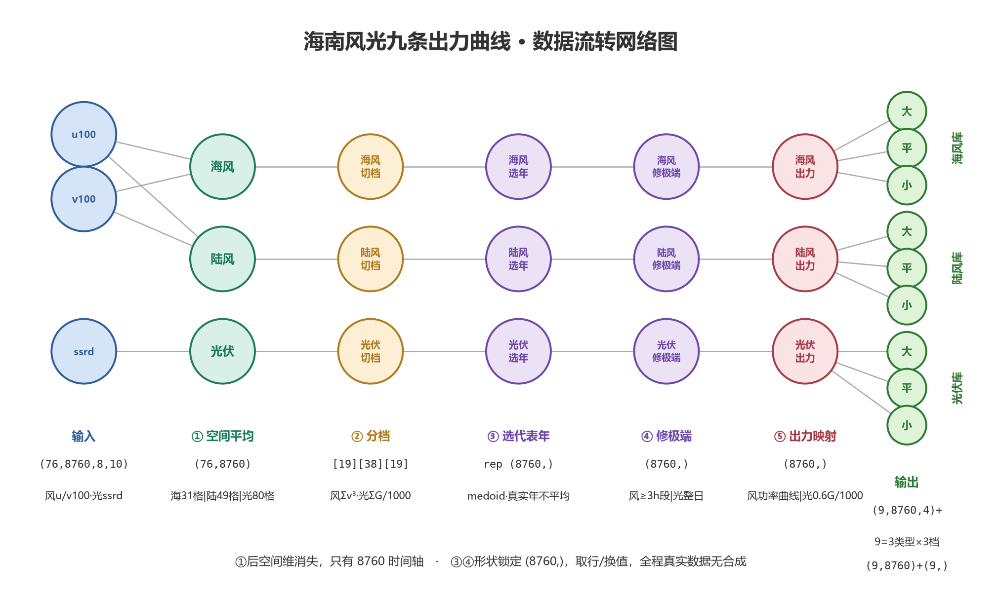

> 示例（海南风光九条出力曲线项目）：只学结构和写法，内容按项目替换。

# 算法设计 · 数据维度流转

## 背景

本项目把海南 1950—2025 年共 76 年的 ERA5 风光资源 NC 数据（风 u100/v100、光伏 ssrd，8×10 网格共 80 格）加工为 9 条 8760 小时归一化出力曲线：海风/陆风/光伏 × 大/平均/小资源年。输入是 hainan 目录下的 wind/、solar/ 两族 NC 文件，输出是 9 个资源库四件套、九条 8760 小时资源与出力总表、最大利用小时表与复核报告。核心设计原则：代表曲线整条取自某个真实年份（不做逐年平均），极端修正确只做真实片段对真实片段的替换，全程无合成数据。

## 流程图



列 = 操作层，节点 = 圆圈，连线 = 数据流；输出层展开 9 库（3 资源类型 × 3 资源档）。

## 维度流转描述

```text
输入
  u100    : (76, 8760, 8, 10)   float32, m/s     76=年份数(1950–2025), 8=纬度格数, 10=经度格数
  v100    : (76, 8760, 8, 10)   float32, m/s     8×10=80个格点
  ssrd    : (76, 8760, 8, 10)   float32, J/m²    同样 80 格，逐时累积辐照
  mask_sea  : (80,)  bool       31个True=海域格
  mask_land : (80,)  bool       49个True=陆域格

stage 1 空间平均
  speed = hypot(u100, v100)          (76, 8760, 8, 10)
  展平空间维 (8,10)→80               (76, 8760, 80)
  海风 = 海格平均(dim=80)            (76, 8760)
  陆风 = 陆格平均(dim=80)            (76, 8760)
  光伏 = 全格平均(dim=80) ÷ 3600     (76, 8760)     J/m² → W/m²

stage 2 分档（三条各自做）
  年指标 = 归约(dim=8760) → 每年一个标量 → (76,)
      风: (1/8760)·Σ_t (v_t)³     先立方再求和——风机功率∝v³，按能量权重计年资源
      光: Σ_t G_t / 1000          直接求和——光伏功率∝G，/1000 仅量纲缩放
  76 年按指标排序切三档 → 索引[19] [38] [19]   19/38/19 = 大/平均/小档年份数

stage 3 选代表年（9个库各自做；库 = 3资源类型 × 3资源档）
  gather 按档取行                    (n, 8760)      n∈{19,38,19}=该档年份数
  库内两两距离和 (n,) → argmin 选1行
  rep（代表年曲线）                  (8760,)        某个真实年份整行原样取出，无任何加权平均

stage 4 修极端（形状不变，替换部分值）
  rep                                (8760,)        风: ≥3h连续段替换；光: 整日24点替换
  修改标记                           (8760,)  bool  1=该小时值是移植换过的，0=代表年原装

stage 5 出力（逐元素映射）
  资源 → 出力                        (8760,)        风: 功率曲线(切入/额定/切出)；光: 0.6·G/1000
  插前、插后各算一遍

总输出（9 = 3资源类型(海风/陆风/光伏) × 3资源档(大/平均/小)）
  资源与出力曲线    (9, 8760, 4)     4 = 插前资源/插后资源/插前出力/插后出力
  修改标记          (9, 8760)  bool
  利用小时          (9,)             每库 = 插后出力沿8760求和，读作"全年等效满发小时数"
```

两条不变式：

- stage 1 之后空间维消失，所有操作都在 8760 时间轴上；
- stage 3 取行、stage 4 换值，形状始终 `(8760,)`，全程无合成数据（真实年不平均、真实片段换真实片段）。

## 步骤与代码模块对应

| stage                           | 模块                                                       |
| ------------------------------- | ---------------------------------------------------------- |
| 网格校验（mask 来源）           | refactor/curve_pipeline/grid_mask.py                       |
| stage 1 空间平均                | refactor/curve_pipeline/nc_cache.py                        |
| stage 2 分档 / stage 3 选代表年 | refactor/curve_pipeline/classify_cluster.py                |
| stage 4 风                      | refactor/curve_pipeline/wind_insert.py                     |
| stage 4 光                      | refactor/curve_pipeline/solar_insert.py                    |
| stage 5 出力映射                | refactor/curve_pipeline/power_curves.py                    |
| 总输出与复核                    | refactor/curve_pipeline/power_curves.py、verify_outputs.py |
