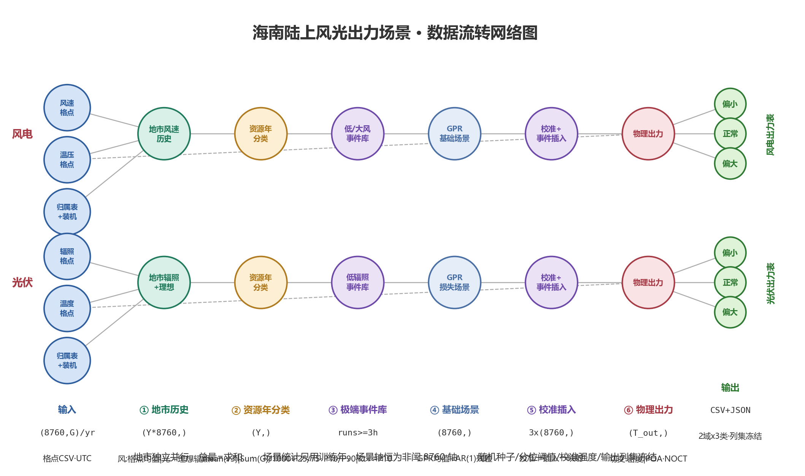

# DESIGN

> 本文件只写算法设计与工程实现；进度在 PLAN.md，决策在 DECISIONS.md，接口格式在 API.md，运行说明在 README.md。

## 算法设计〔草案〕

### 背景〔草案〕

问题：为海南陆上风电与光伏生成指定输出年、三类资源年（偏小/正常/偏大）的逐小时出力场景。输入：ERA5 格点气象 CSV（100 米风速、辐照度、2 米温度、地面气压，UTC 口径）、格点归属表（地市 → 严格边界内格点）、装机配置（风电机型 / 光伏组件与容量）。方法：格点聚合到地市 → 逐年资源指标分位分类 → 极端事件库与分年景分月标准 → GPR 均值 + AR(1) 残差采样生成基础场景 → 分位数校准 + 极端事件插入 → 物理模型转出力 → 地市求和。输出：出力 CSV 与 JSON `power_table` 双份，列集冻结。原则：地市独立并行无跨市耦合；场景统计只用训练年，场景轴年只当日历模板；随机种子与算法常数代码内冻结。

原始资料：`docs/ref/新能源出力_陆上.md`（配置与校验说明）、`陆上全省风电出力部署/`、`陆上全省光伏出力部署/`、`光伏出力部署/`（旧部署脚本，算法逐行出处）。

### 流程图〔草案〕



列 = 阶段（①~⑥），行 = 风电/光伏两条并行分支；温压/温度格点虚线直通 ⑥（全流程唯一读输出年数据的地方）。画图脚本 `docs/make_flowchart.py`，流程变更后重跑更新 PNG。

### 维度流转〔草案〕

```text
输入（每地市独立，C 个地市并行；风 Y=26 年 2000–2025，运行时按数据目录解析）
  风速格点CSV   : (Y, 8760, G_w)   float, m/s    每年一文件，UTC；G_w=该市严格边界内风速格点数
  温压格点CSV   : (1, T_out, G)    float, K/Pa   仅输出年（空气密度修正用）
  辐照格点CSV   : (Y, 8760, G_s)   float, W/m2   光伏历史
  温度格点CSV   : (Y, 8760, G_t)   float, K      光伏读训练年（气候态）
  归属表        : (C,) 表                         地市 → 严格边界内格点列名（风/光各自列）
  装机配置      : (C,) 表                         地市 → capacity_mw + turbines[M] | components[K]

stage 1 地市历史（风/光共用 utils 层）
  格点均值(axis=G) → (Y, 8760)    UTC 口径
  +8h 转北京、连续小时轴时间插值、clip≥0
  删 2/29 → (Y·8760,)              每地市一条 Series，按年分段
  光伏分支并行生成理想辐照度 (Y·8760,)（天文公式逐时，同时间轴）

stage 2 资源年分类（各地市独立）
  风: 逐年 mean(v³) → (Y,)         归约沿 8760 小时；功率∝v³ 按能量权重计年资源
  光: 逐年 ΣG/1000  → (Y,) kWh/m2  归约沿 8760 小时
  训练年上 P25/P75 → 每年 ∈ {偏小, 正常, 偏大}

stage 3 极端事件库（只用训练年）
  风: 全历史 P10/P90 阈值，低风/大风连续段≥3h → 事件表 (E,) + 事件段（可变长）
  光: 晴空指数 Kt=GHI/理想（截 [0,1.2]），核心日照（理想>200 W/m2）内 Kt≤P10 段≥3h
      → 事件段存辐照损失 = clip(理想−GHI)
  标准：分年景 × 分月年均事件次数 (3, 12)

stage 4 基础场景（GPR + AR(1)，每地市拟合一次，三 case 共用）
  时间特征 (T, 7|8)：年/日/月三角函数 + 年内进度；光伏再加理想辐照
  GPR（C·RBF+White，核参数全 fixed，抽样 800|900 点）拟合均值 → 轴年逐时预测 (8760,)
  残差 AR(1)：φ=lag1 自相关截 [0, 0.97]；高斯 latent → 经验分位取样残差
  风: base = 预测 + 残差采样，clip≥0
  光: 在损失域 loss=clip(理想−GHI)，白天内按月池、按日链采样；GHI = 理想 − loss

stage 5 校准与事件插入（每 case 一条，case ∈ {偏小, 正常, 偏大}）
  风: 逐月水平校准 → 逐月软分位校准(1.0) → 事件插入(±3h 坡度)
      → 全局分位映射(0.5) → 均值回拉(0.3)
  光: 白天分位校准(月×时, 0.45) → 损失事件插入(±3h 坡度)
      → 月能量校正(系数截 [0.70,1.60]，封顶理想)
  → 3 × (8760,)                     三类场景，同轴年非闰时间轴

stage 6 物理出力
  remap 到输出年 (T_out,)            闰年时间插值补 2/29；场景数值不变
  风: 切变 (h/100)^α → 轮毂风速；温压 → 轮毂 ρ/ρ0；立方曲线 (v³−vin³)/(vr³−vin³)
      多机型 count·rated·scale 叠加 → ×loss_factor → 地市出力 (T_out,)
  光: GHI → POA（直射+散射+地面反射）→ NOCT 组件温度 → g/1000·(1+γ(tc−25))
      多组件 count·rated·scale 叠加 → ×loss_factor → 地市出力 (T_out,)
  地市求和 → 全省/区域表

输出（CSV + JSON power_table 双份，同列同值；b=output_city_power∈{0,1}）
  风电出力表 : (T_out, 4+C·b)   time、省风速(容量加权)、省出力 MW/pu、{地市}_power_mw
  光伏出力表 : (T_out, 3+C·b)   时间、区域出力 MW/pu、{地市}_总出力_MW
```

不变量：

- 地市独立并行，无跨地市耦合；全省/区域总量 = 地市之和（风电另有容量加权风速列）
- 场景统计只用训练年；轴年（最后一年）数据不进任何统计，只作 8760 非闰日历模板
- 场景生成恒在非闰 8760 轴上，输出前统一 remap 到请求年份
- 冻结：随机种子、分位阈值（P25/P75、P10/P90、Kt 0.10）、校准强度、输出列集

### 模块对应〔草案〕

| 阶段          | 风电                                  | 光伏                                    | 公共                                              |
| :------------ | :------------------------------------ | :-------------------------------------- | :------------------------------------------------ |
| ① 地市历史   | `wind/history.py`                   | `solar/history.py`（含 city_centers） | `utils/city_weather.py`、`utils/time_axis.py` |
| ② 资源年分类 | `wind/classify.py`                  | `solar/classify.py`                   | —                                                |
| ③ 极端事件库 | `wind/events.py`                    | `solar/events.py`                     | —                                                |
| ④⑤ 场景生成 | `wind/generate.py`                  | `solar/generate.py`（含理想辐照度）   | —                                                |
| ⑥ 物理出力   | `wind/power.py`                     | `solar/power.py`（含温度气候态）      | —                                                |
| 可选评估      | `wind/evaluate.py`                  | —                                      | —                                                |
| 组织/入口     | `wind/pipeline.py`、`run_wind.py` | `solar/pipeline.py`、`run_solar.py` | `utils/request.py`（校验+常数）                 |

分层依赖单向：入口 → 组织 → 单元 → 公共，禁止反向 import；风电/光伏互不引用，共用公共层。

#### 目标结构〔草案〕（P6 重构，D-42~D-45）

```
new_energy/            算法包：只做计算，数据进、结果出，全程内存
├─ run.py              唯一入口 run(kind, data, config)
├─ pipeline.py         一条流程骨架；风/光 = 换一组步骤函数的组合
├─ classify.py         资源年分类（年归约函数作参数）
├─ events.py           contiguous_runs 共用 + 风/光各自的提取器
├─ scenario.py         GPR+AR(1)/分位校准/坡度插入机器共用；风/光各留一条薄校准链
├─ power.py            风机曲线、光伏模型；只返回结果对象（各单元出力、全省汇总、容量加权风速）
├─ evaluate.py         可选评估（不动）
└─ utils/time_axis.py  时间轴纯函数（不动）

biz/                   业务层：读取 + 组装 + 保存
├─ request.py          统一 JSON 校验（原 utils/request.py + 两条 _parse_request 合并成一份）
├─ assignment.py       归属表、单元名匹配、格点→单元序列（原 utils/city_weather.py 迁入）
└─ runner.py           组装入口：校验 → 取数 → 调算法 → 组装冻结列集输出表 → 写 CSV → 结果 JSON

api/                   接口层：routers 改调 biz.runner，其余不动
```

依赖单向 api → biz → new_energy；run_wind.py/run_solar.py 合并为一个薄 CLI 调 biz.runner。边界：跨单元汇总属算法（power 返回结果对象），输出表组装与写文件属业务层。约束：API.md 接口格式与输出 CSV 列集冻结不变，重构后跑 `.refactor_baseline/` 结果比对。

## 工程实现〔草案〕

### 对象分类表〔草案〕

| 类型 | 对象               | 模块                                                                                           |
| ---- | ------------------ | ---------------------------------------------------------------------------------------------- |
| 请求 | 请求解析与单元匹配 | `wind/pipeline.py`、`solar/pipeline.py`（`_parse_request`）、`utils/request.py`        |
| 数据 | 格点读取与历史序列 | `utils/city_weather.py`、`utils/time_axis.py`                                              |
| 算法 | 资源年分类         | `wind/classify.py`、`solar/classify.py`                                                    |
| 算法 | 极端事件库         | `wind/events.py`、`solar/events.py`                                                        |
| 算法 | 场景生成与校准     | `wind/generate.py`、`solar/generate.py`                                                    |
| 算法 | 物理出力           | `wind/power.py`、`solar/power.py`                                                          |
| 组织 | 流程组织           | `wind/pipeline.py`、`solar/pipeline.py`（`_compute`）、`run_wind.py`、`run_solar.py` |

### 请求解析与单元匹配〔草案〕

描述：pipeline 唯一入口收统一 JSON（文件路径 / dict 两种形态），完成校验、默认值填充与单元名匹配；全项目唯一校验点。

变量：

| 变量                    | 值                                                                                                                      | 说明                                                    |
| ----------------------- | ----------------------------------------------------------------------------------------------------------------------- | ------------------------------------------------------- |
| `DEFAULT_DATA_DIR`    | `data/hainan_era5_grid_csv`                                                                                           | 缺省数据目录（utils/request.py）                        |
| `DEFAULT_ASSIGNMENT`  | `data/全国格点地市归属.csv`                                                                                           | 缺省归属表（D-28/D-41），368 单元、每行一个格点数值坐标 |
| `DEFAULT_YEARS`       | (2000, 2025) 两端含                                                                                                     | 历史年份期望窗口                                        |
| `MIN_HISTORY_YEARS`   | 12                                                                                                                      | 年份数下限                                              |
| `RANDOM_SEED`         | 20261008                                                                                                                | 场景生成种子，冻结                                      |
| `RESOURCE_YEAR_TYPES` | 偏小/正常/偏大资源年                                                                                                    | 枚举                                                    |
| `ENC`                 | utf-8-sig                                                                                                               | 全部 CSV 读写编码                                       |
| `KIND_PREFIX`         | wind=`wind_speed_100m`、solar=`irradiance_w_m2`、temperature=`temperature_2m_k`、pressure=`surface_pressure_pa` | `variable_prefixes` 的缺省前缀                        |
| `loss_factor`         | 1.0                                                                                                                     | 可传                                                    |
| `albedo`（光伏）      | 0.2                                                                                                                     | 可传                                                    |
| `output_city_power`   | True                                                                                                                    | 可传                                                    |
| `evaluate`（风电）    | False                                                                                                                   | 可传                                                    |
| `city_configs`        | 缺省读`default_city_configs.json`（风电=全省 18 地市、光伏=儋州）                                                     | 可传                                                    |

规则：

- 单元名匹配（D-29）：全部命中归属表 → 格点由归属表给出；单元数 >1 且任一未命中 → `ValueError`（违法数据）；单元数 =1 且未命中 → 传入数据中声明前缀的全部格点列均值聚合为该单元序列。单元名键 = DataV 行政区划码_城市名（如 `460100_海口市`），须与 DataV 完全一致。
- `variable_prefixes: {kind: 前缀}`（风电键 wind/temperature/pressure，光伏 solar/temperature）：列匹配按经纬度数值键（保留 2 位小数）查表，命中列前缀须等于声明前缀（变量身份校验，防 10m/100m 风速混装），不符报错指明坐标与现有前缀；容 `19.0/19.00` 格式差。
- 未命中单元的格点列清单取自实际读取的首个年份文件，文件中出现其它前缀的格点列即报错；风速/温度/气压三类数据须同一套格点（现状数据已核实）。
- 光伏单元 `latitude`/`longitude` 可选：命中单元缺省 = 归属表格点中心；未命中单单元缺省 = 数据格点坐标均值（`region_center`）。
- 逐层未知字段拒绝；`scenario.year` 整数、`resource_year_type` 枚举；机型 `count` 正整数、`rated_power_mw`>0，`efficiency`/`wind_shear_exponent` 缺省 1.0/0.15；组件 `count` 正整数、`rated_power_mw`>0；lat ∈ [-90,90]、lon ∈ [-180,180]；重复单元报错；`data_dir` 须含所需子目录（风电 wind/temperature/pressure，光伏 solar/temperature），风电输出年温压文件必须存在。
- 容量口径：`capacity_mw` 为权威值，机组/组件 count×rated 合计等比缩放到它（出处：docs/ref/新能源出力_陆上.md「地市容量与机组容量的实际关系」）。
- 计算范围只由 `city_configs` 键决定；聚合列名不随范围变，范围靠返回 `cities` 自曝。
- 校验失败一律 `ValueError` 指明字段/文件/单元（服务层映射 400）。

输入：统一 JSON（字段表见 API.md）
输出：校验后的配置 dict（含 `direct_unit`、`variable_prefixes`、默认值）

### 格点读取与历史序列〔草案〕

描述：按归属表把格点 CSV 聚合为单元历史序列（算法设计 stage 1），并解析历史年份窗口。

结构：归属表两种结构均兼容——全国表（每行一个格点数值坐标）与海南旧表（`wind_grid`/`solar_grid` 列名，经 `assignment_file` 传入）。

规则：

- 历史年份解析（`resolve_years`）：期望窗口 `DEFAULT_YEARS` ∩ 目录实际年份（风电=wind，光伏=solar∩temperature）→ 最大连续段，段外告警丢弃；逐年行数校验闰 8784/平 8760，不符 `ValueError`；年份数 ≥ `MIN_HISTORY_YEARS`；训练年 = 除最后一年，场景轴年 = 最后一年（数据不进统计，只当日历模板）。
- 聚合：格点均值（沿格点维）→ +8h 转北京 → 连续小时轴时间插值 → clip≥0 → 删 2/29，得每单元 (Y·8760,) Series。
- 数值红线：缺列、缺值、缺文件、缺记录立即报错；NaN/Inf 不进计算；浮点比较用容差。

输入：格点 CSV（`data_dir/{kind}/hainan_{kind}_{年}.csv`，UTC，time + `前缀_lat_XX.XX_lon_XXX.XX` 列）、归属表
输出：每单元历史 Series；`region_center`（格点坐标均值）

### 资源年分类〔草案〕

描述：逐年资源指标在训练年分位上三分（算法设计 stage 2）。

变量：分位阈值 0.25/0.75（`wind/classify.py`、`solar/classify.py`，冻结）。

规则：风 = 逐年 mean(v³)（功率∝v³，按能量权重）；光 = 逐年 ΣG/1000（kWh/m²）；训练年上 P25/P75 切偏小/正常/偏大。公式出处见算法设计「维度流转」stage 2。

输入：单元历史序列（训练年）
输出：每年资源年标签

### 极端事件库〔草案〕

描述：训练年上的极端事件段与分年景分月标准（算法设计 stage 3）。

变量：风 P10/P90、最短持续 3h（`wind/events.py`）；光核心日照阈值 200 W/m²、Kt 分位 0.10、Kt 上限 1.2（`solar/events.py`），均冻结。

规则：风 = 低风/大风连续段≥3h；光 = Kt=GHI/理想（截 [0,1.2]），核心日照内 Kt≤P10 段≥3h，事件段存损失 = clip(理想−GHI)；标准 = 分年景×分月年均次数 (3,12)。

输入：单元历史、理想辐照度（光）
输出：事件表与事件段

### 场景生成与校准〔草案〕

描述：GPR 均值 + AR(1) 残差采样生成基础场景，逐 case 校准与事件插入（算法设计 stage 4/5）。

变量（均冻结）：

| 变量         | 风                                         | 光                                               |
| ------------ | ------------------------------------------ | ------------------------------------------------ |
| GPR 抽样点数 | 800                                        | 900                                              |
| 时间特征维数 | 7                                          | 8（加理想辐照度）                                |
| AR(1) φ     | lag1 自相关截 [0, 0.97]                    | 同左                                             |
| 校准强度     | 软分位 1.0 / 全局映射 0.50 / 均值回拉 0.30 | 白天分位混合 0.45                                |
| 其它         | —                                         | 白天阈值 50 W/m²；月能量校正系数截 [0.70, 1.60] |

规则：见算法设计「维度流转」stage 4/5；光伏在损失域采样（GHI = 理想 − loss，封顶理想）；场景恒在非闰 8760 轴上生成。

输入：单元历史（训练年）、轴年时间特征
输出：3 × (8760,) 场景序列

### 物理出力〔草案〕

描述：场景序列经物理模型转出力并汇总（算法设计 stage 6）。公式出处：`陆上全省风电出力部署/部署说明.md`、`光伏出力部署/光伏场景与物理出力部署说明.md`。

变量：`RHO_REF`=1.225 kg/m³、`GAMMA`=0.0065 K/m、`GRAVITY`=9.80665 m/s²、`R_D`=287.05 J/(kg·K)（`wind/power.py`，冻结）。

规则：风 = 切变 (h/100)^α → 轮毂风速；温压 → 轮毂 ρ/ρ0；立方曲线 (v³−vin³)/(vr³−vin³)；×count×rated×scale×loss_factor。光 = GHI→POA（直射+散射+地面反射 albedo）→ NOCT 组件温度 → g/1000×(1+γ(tc−25))；×count×rated×scale×loss_factor。输出年 remap：闰年时间插值补 2/29，场景数值不变。

输入：场景序列、输出年温压（风）、装机配置
输出：单元出力 (T_out,)、全省/区域汇总表

### 跨对象〔草案〕

- 依赖单向分层（见「模块对应」）；风电/光伏互不引用，共用 `utils/`。
- 单元独立并行，无跨单元耦合；汇总 = 各单元之和（风电另有容量加权风速列）。
- 冻结常数（种子、分位阈值、校准强度）改动即改结果，回归基准件 `.refactor_baseline/`。
- 可选评估 `wind/evaluate.py` 默认不运行（`evaluate` 缺省 False）。
- 口径提醒：单单元 + 数据含全省格点时，出力是单条聚合序列口径，与多行政单元汇总不同（丢各市资源差异）。

### 输入汇总〔草案〕

| 输入         | 格式                                                                                                                    |
| ------------ | ----------------------------------------------------------------------------------------------------------------------- |
| 格点气象 CSV | `data_dir/{wind,solar,temperature,pressure}/hainan_{类型}_{年}.csv`，UTC，time + `前缀_lat_XX.XX_lon_XXX.XX` 格点列 |
| 格点归属表   | 缺省`data/全国格点地市归属.csv`；可经 `assignment_file` 传海南旧表                                                  |
| 装机配置     | 统一 JSON`city_configs`（字段表见 API.md）                                                                            |

### 输出汇总〔草案〕

- 风电 CSV：`time, province_wind_speed_m_s, province_power_mw, province_power_pu, {单元名}_power_mw×N`，闰 8784/平 8760 行
- 光伏 CSV：`时间, {单元名}_总出力_MW×N, 区域总出力_MW, 区域总出力_pu`，8760 行
- 列集、行序、精度为冻结对外约定，改动前先记 DECISIONS.md；回归基准件 `.refactor_baseline/`
- 返回 JSON：`output_file, elapsed_s, scenario, cities, total_capacity_mw, power_table`（字段表见 API.md）
