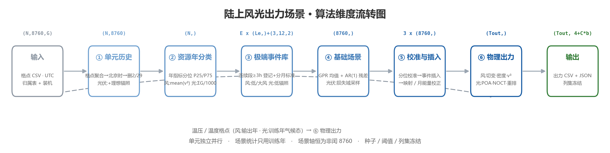

# DESIGN

> 本文件只写算法设计与工程实现；进度在 PLAN.md，决策在 DECISIONS.md，接口格式在 API.md，运行说明在 README.md。

## 算法设计〔草案〕

### 背景〔草案〕

问题：为全国任选一组行政单元的陆上风电与光伏电站，生成指定输出年、三类资源年（偏小/正常/偏大）的逐小时出力场景，供电力规划做边界情景输入。

- 输入：ERA5 格点气象 CSV（100 米风速、辐照度、2 米温度、地面气压，UTC 口径）、全国格点归属表（单元 → 严格边界内格点，D-54）、装机配置（风电机型 / 光伏组件与容量），统一 JSON 提交（字段表见 API.md）
- 方法：格点聚合到单元 → 逐年资源指标分位分类 → 极端事件库与分年景分月标准 → GPR 均值 + AR(1) 残差采样基础场景 → 分位数校准 + 极端事件插入 → 物理模型转出力 → 单元求和
- 输出：出力 CSV 与 JSON `power_table` 双份，列集冻结
- 原则：单元独立并行无跨单元耦合；场景统计只用训练年，轴年只当日历模板；随机种子与算法常数代码内冻结；分层 api → biz → new_energy 单向依赖，算法只算内存（D-44）

原始资料：`docs/ref/新能源出力_陆上.md`（配置与校验说明）、`陆上全省风电出力部署/`、`陆上全省光伏出力部署/`、`光伏出力部署/`（旧部署脚本，算法逐行出处）。

### 流程图〔草案〕



主链一条 = 「维度流转」总流转式：框 = 阶段（①~⑥），框上标注该阶段输出维度，框内两行写风/光差异；温压/温度格点虚线弧直通 ⑥（全流程唯一绕过主链的输入）。画图脚本 `docs/make_flowchart.py`，流程变更后重跑更新 PNG。

### 维度流转〔草案〕

输入（每单元独立，C 个单元并行；N=26 年 2000–2025，运行时按数据目录解析）：

| 数据 | 维度 | 口径/单位 | 说明 |
| :--- | :--- | :--- | :--- |
| 风速格点 CSV | (N, 8760, G_w) | m/s，UTC，每年一文件 | $G_w$ = 该单元严格边界内风速格点数 |
| 温压格点 CSV | (1, T_out, G) | K / Pa，仅输出年 | 空气密度修正用 |
| 辐照格点 CSV | (N, 8760, G_s) | W/m²，UTC | 光伏历史 |
| 温度格点 CSV | (N, 8760, G_t) | K | 光伏读训练年（气候态） |
| 归属表 | (C,) 表 | — | 单元 → 严格边界内格点坐标 |
| 装机配置 | (C,) 表 | — | 单元 → capacity_mw + turbines[M] \| components[K] |

维度总流转：

```text
(N, 8760, G) → (N, 8760) → (N,) → E × (L_e,) + (3, 12, 2) × 2 → (8760,) → 3 × (8760,) → (T_out,) → (T_out, 4+C·b | 3+C·b)
   格点聚合       单元历史     年指标   事件段库+索引+标准   基础场景     三类场景       物理出力       单元求和输出表
```

#### stage 1 单元历史 (N, 8760, G) → (N, 8760)：把格点 CSV 变成单元逐小时历史序列

- 格点均值（沿格点维）：$\bar{x}_h = \frac{1}{G}\sum_{g=1}^{G} x_{g,h}$ → (N, 8760)，UTC
- +8h 转北京时轴、连续小时轴时间插值、$\max(x, 0)$
- 删 2/29 → 每单元一条 Series (N·8760,)，按年分段
- 风（wind.py）/ 光（solar.py）：装箱 (N, 8760) ndarray，月切片查 `MONTH_STARTS` 表；pandas 只在门口（对齐入）与出口（remap、Series 封装）
- 光伏分支并行生成理想辐照度 $G_{ideal}$ (N·8760,)（天文公式逐时，同时间轴）

#### stage 2 资源年分类 (N, 8760) → (N,)：把历史压成每年一个资源年标签

- 风指标（功率 ∝ $v^3$，按能量权重）：$m_y = \frac{1}{8760}\sum_{h} v_{y,h}^{3}$ → (N,)
- 光指标：$m_y = \frac{1}{1000}\sum_{h} G_{y,h}$（kWh/m²）→ (N,)
- 训练年分位 $q_{25}, q_{75}$：$m_y \le q_{25}$ 偏小、$m_y \ge q_{75}$ 偏大、其余正常

#### stage 3 极端事件库 (N, 8760) → 事件登记表 E 行 + 两个 (3, 12, 2) groupby 视图：把训练年切成极端事件段并统计标准（只用训练年）

- 事件提取（风）：全历史阈值 $P_{10}/P_{90}$，低风（$v \le P_{10}$）/大风（$v \ge P_{90}$）连续段 ≥ 3h 记一个事件；E = 事件总数
- 事件提取（光）：晴空指数 $K_t = \mathrm{clip}\!\left(\frac{\mathrm{GHI}}{G_{ideal}},\ 0,\ 1.2\right)$，核心日照（$G_{ideal} > 200\ \mathrm{W/m^2}$）内 $K_t \le P_{10}$ 连续段 ≥ 3h 记一个低辐照事件
- 输出 = 一张事件登记表 + 按（年景类型 × 月份 × 类型）的两次 groupby（下例为风；光同构，段存辐照损失 $\mathrm{clip}(G_{ideal} - \mathrm{GHI},\ 0,\ +\infty)$）

事件登记表（每事件一行；年景类型 = 来源年份的训练标签）：

| event_id | 年份 | 年景类型 | 月份 | 类型 | 段 $(L_e,)$ 逐小时 |
| :--- | :--- | :--- | :--- | :--- | :--- |
| WIND_低风_00003 | 2001 | 偏小资源年 | 2 | 低风 | [2.1, 2.0, 2.3, 2.2, 2.4, 2.1] |
| WIND_低风_00089 | 2007 | 偏小资源年 | 2 | 低风 | … |
| WIND_低风_00090 | 2007 | 偏小资源年 | 2 | 低风 | … |

| 视图 | 格子的值 | 例（偏小资源年, 2 月, 低风） |
| :--- | :--- | :--- |
| groups | 该格登记行列表（稀疏，多数格空） | 3 行：00003 / 00089 / 00090 |
| standards | 该格行数 ÷ 该年景训练年数（稠密 72 格恒全，无事件为 0） | 3 ÷ 2 年 = 1.5 次/年 |

- 段列变长（3h 起至数十小时），是唯一进不了规整矩阵的部分；源码物化为 `EventDetails` 类：(E, 5) 明细矩阵（列 = 年份/类型/起点/时长/月份，风速值不复制）+ 现取方法（`pool` 布尔筛行、`n_case_years` 行数÷年数、`segment` train_grid 切片）
- 事件类型只有偏小方向（风=低风、光=低辐照）与偏大方向（风=大风，光伏无）两类；「正常」年景无专属事件类型，其标准 = 正常年景历史上同类事件的出现频率。风 (3, 12, 2) = 72 键，光 (3, 12)

#### stage 4 基础场景 (N, 8760) → (8760,)：GPR 均值 + AR(1) 残差采样（每单元拟合一次，三 case 共用）

- 时间特征 (T, 7|8)：年/日/月三角函数 + 年内进度；光伏再加理想辐照
- GPR（C·RBF+White，核参数全 fixed，抽样 800|900 点）拟合均值 → 轴年逐时预测 $\mu(x^*)$ → (8760,)
- 残差 AR(1)：$\phi = \mathrm{clip}(\text{lag1 自相关},\ 0,\ 0.97)$；高斯 latent → 经验分位取样残差 $\epsilon$
- 风：$\mathrm{base} = \max(\mu + \epsilon,\ 0)$
- 光：在损失域 $\mathrm{loss} = \mathrm{clip}(G_{ideal} - \mathrm{GHI},\ 0,\ +\infty)$，白天内按月池、按日链采样；$\mathrm{GHI} = G_{ideal} - \mathrm{loss}$

#### stage 5 校准与事件插入 (8760,) → (3, 8760)：把基础场景整形成三类资源年场景矩阵（行序 case ∈ {偏小, 正常, 偏大}），forward 装箱为 {case: Series}

- 风：逐月水平校准 → 逐月软分位校准（强度 1.0）→ 事件插入（±3h 坡度）→ 全局分位映射（强度 0.5）→ 均值回拉（强度 0.3）
- 光：白天分位校准（月×时，混合 0.45）→ 损失事件插入（±3h 坡度）→ 月能量校正（系数截 $[0.70, 1.60]$，封顶理想）
- → 3 × (8760,)，三类场景，同轴年非闰时间轴

#### stage 6 物理出力 3 × (8760,) → (T_out,) → (T_out, 4+C·b | 3+C·b)：场景序列经物理模型转出力并汇总

- remap 到输出年 (T_out,)：闰年时间插值补 2/29，场景数值不变；风 = 重排后物理出力，光 = 轴年物理出力后重排（辐照随日历走，顺序不可换）
- 风：切变 $v_{hub} = v \cdot (h/100)^{\alpha}$；温压 → 轮毂密度比 $\rho/\rho_0$；立方曲线 $\frac{v^3 - v_{in}^3}{v_r^3 - v_{in}^3}$；多机型 $\sum_m \mathrm{count}_m \cdot \mathrm{rated}_m \cdot \mathrm{scale}_m$ → ×loss_factor → 单元出力 (T_out,)
- 光：GHI → POA（直射+散射+地面反射）→ NOCT 组件温度 → $\frac{g}{1000}\left(1 + \gamma\,(t_c - 25)\right)$；多组件同式叠加 → ×loss_factor → 单元出力 (T_out,)
- 单元求和 → 全省/区域表

输出（CSV + JSON power_table 双份，同列同值；b=output_city_power∈{0,1}）：

- 风电出力表 (T_out, 4+C·b)：time、省风速（容量加权）、省出力 MW/pu、{单元}_power_mw
- 光伏出力表 (T_out, 3+C·b)：时间、区域出力 MW/pu、{单元}_总出力_MW

不变量：

- 单元独立并行，无跨单元耦合；全省/区域总量 = 单元之和（风电另有容量加权风速列）
- 场景统计只用训练年；轴年（最后一年）数据不进任何统计，只作 8760 非闰日历模板
- 场景生成恒在非闰 8760 轴上，输出前统一 remap 到请求年份
- 冻结：随机种子、分位阈值（P25/P75、P10/P90、Kt 0.10）、校准强度、输出列集

### 模块对应〔草案〕

| 层   | 模块                                                                     | 职责                                                                                                                    |
| :--- | :----------------------------------------------------------------------- | :---------------------------------------------------------------------------------------------------------------------- |
| 接口 | `api/routers/wind_router.py`、`solar_router.py` | POST `/run` 透传统一 JSON 给 `biz.runner.run`，不重复校验 |
| 接口 | `run.py` | 薄 CLI：`python run.py wind/solar 配置.json` → `biz.runner.run` |
| 业务 | `biz/schema.py`                                                        | 统一 JSON 校验、默认值、机组配置构造（`Schema`/`RequestBase`）                                                      |
| 业务 | `biz/assignment.py`                                                    | 全国归属表一遍读入（`Assignment`：keys/coords/centers，D-54）                                                         |
| 业务 | `biz/years.py`                                                         | 历史年份方案（`YearsPlan`：source/train/axis）                                                                        |
| 业务 | `biz/grids.py`                                                         | 格点读取聚合（`GridData`：坐标键匹配、前缀身份校验、格点均值）                                                        |
| 业务 | `biz/reader.py`                                                        | 取数编排 + 算法配置构造（`Reader`，D-51）                                                                             |
| 业务 | `biz/runner.py`                                                        | 总装：校验→匹配→取数→模型→写出（`Runner`/`run`）                                                                |
| 业务 | `biz/export.py`                                                        | 冻结列集输出表与结果 JSON（`Export`，D-45）                                                                           |
| 业务 | `biz/constants.py`                                                     | 业务常数：编码、年份窗口、类型前缀                                                                                      |
| 算法 | `new_energy/wind.py`                                                   | 风电模型：`EventDetails`→`BaseScene`→`Generator`→`Evaluate`→`Physics`（对齐用共用 `Align`），`WindModel` 组装，`run_wind` 并行 |
| 算法 | `new_energy/solar.py`                                                  | 光伏模型：`EventDetails`→`BaseLoss`→`Generator`→`Physics`（对齐用共用 `Align`），`SolarModel` 组装，`run_solar` 并行 |
| 算法 | `new_energy/align.py`                                                  | 数据对齐（风/光共用 `Align`：UTC → 北京时 (年数, 8760) 装箱）                                                          |
| 算法 | `new_energy/config.py`                                                 | 配置数据类（构造即校验 D-50）、强度与抽样参数                                                                           |
| 算法 | `new_energy/constants.py`                                              | 冻结常数：种子、资源年枚举、物理常数、共用生成参数（`GPR_CHUNK_SIZE`/`PHI_MAX`/`RAMP_HOURS`）                          |
| 算法 | `new_energy/result.py`                                                 | 结果对象：`PowerResult`（风/光共用）、`WindResult`、`SolarResult`                                                      |
| 算法 | `new_energy/evaluate.py`、`utils/time_axis.py`、`utils/common.py`     | 可选评估；时间轴纯函数（含 `MONTH_STARTS`/`month_of`/`year_grid` 风/光共用查表）；零散共用工具（`worker_logging`/`quantile_map`） |

依赖单向 api → biz → new_energy，禁止反向；风/光互不引用，共用 align、config、constants、result、utils（time_axis/common）；biz/runner 接 `run_wind`/`run_solar`（P7 已完成，旧 pipeline/events/generate/power 已删）。

## 工程实现〔草案〕

### 对象分类表〔草案〕

| 类型 | 对象                                    | 模块                                                                         |
| ---- | :-------------------------------------- | :--------------------------------------------------------------------------- |
| 请求 | JSON 校验与单元匹配                     | `biz/schema.py`、`biz/runner.py`（`Runner.request`）                   |
| 数据 | 归属表 / 年份方案 / 格点读取 / 取数编排 | `biz/assignment.py`、`biz/years.py`、`biz/grids.py`、`biz/reader.py` |
| 算法 | 风电模型                                | `new_energy/wind.py`                                                       |
| 算法 | 光伏模型                                | `new_energy/solar.py`                                                              |
| 算法 | 风/光共用件                             | `new_energy/align.py`、`result.py`、`utils/time_axis.py`、`utils/common.py` |
| 算法 | 配置与常数                              | `new_energy/config.py`、`new_energy/constants.py`、`biz/constants.py`  |
| 算法 | 可选评估                                | `new_energy/evaluate.py`                                                   |
| 组织 | 流程总装与写出                          | `biz/runner.py`、`biz/export.py`                                         |
| 接口 | HTTP 路由 / CLI                         | `api/routers/`、`run.py`                                                 |

### 请求与单元匹配〔草案〕

描述：`Runner.request` 收统一 JSON（dict / 文件路径）→ `Schema` 校验与默认值填充 → 单元名匹配 → 光伏经纬度补全；数值校验随配置构造走（`new_energy/config.py` 各数据类 `__post_init__`，D-50）。

变量：

| 变量                                                                | 值                                                                                                                      | 位置                                               |
| :------------------------------------------------------------------ | :---------------------------------------------------------------------------------------------------------------------- | :------------------------------------------------- |
| `DEFAULT_DATA_DIR`                                                | `data/hainan_era5_grid_csv`                                                                                           | `biz/schema.py`                                  |
| `DEFAULT_ASSIGNMENT`                                              | `data/全国格点地市归属.csv`（426 单元，D-28/D-41/D-54）                                                               | `biz/schema.py`                                  |
| `DEFAULT_YEARS`                                                   | (2000, 2025) 两端含                                                                                                     | `biz/constants.py`                               |
| `MIN_HISTORY_YEARS`                                               | 12                                                                                                                      | `biz/constants.py`                               |
| `ENC`                                                             | utf-8-sig（全部 CSV 读写）                                                                                              | `biz/constants.py`                               |
| `KIND_PREFIX`                                                     | wind=`wind_speed_100m`、solar=`irradiance_w_m2`、temperature=`temperature_2m_k`、pressure=`surface_pressure_pa` | `biz/constants.py`（`variable_prefixes` 缺省） |
| `RANDOM_SEED`                                                     | 20261008（冻结）                                                                                                        | `new_energy/constants.py`                        |
| `RESOURCE_YEAR_TYPES`                                             | 偏小/正常/偏大资源年                                                                                                    | `new_energy/constants.py`                        |
| `loss_factor` / `albedo` / `output_city_power` / `evaluate` | 1.0 / 0.2 / True / False                                                                                                | 请求字段，可传                                     |
| `city_configs`                                                    | 缺省读`default_city_configs.json`                                                                                     | `biz/schema.py`                                  |

规则：

- 单元名匹配（D-29、D-53）：单元名键 = DataV 行政区划码_城市名（如 `460100_海口市`）。全部命中 → 格点由归属表给出；部分命中 → 未命中的跳过并告警（无格点单元，如东城区）；多单元全部未命中 → `ValueError`；单单元未命中 → 合法自定义区域，格点 = 传入数据中声明前缀的全部格点列均值聚合。
- `variable_prefixes: {kind: 前缀}`（风电 wind/temperature/pressure，光伏 solar/temperature）：列匹配按经纬度数值键（保留 2 位小数）查表，命中列前缀须等于声明前缀（变量身份校验，防 10m/100m 风速混装），不符报错指明坐标与现有前缀；容 `19.0/19.00` 格式差。
- 光伏单元 `latitude`/`longitude` 可选：命中单元缺省 = 归属表格点中心；未命中的单单元缺省 = 数据格点坐标均值（`GridData.center`）。
- 逐层未知字段拒绝；`scenario.year` 整数、`resource_year_type` 枚举；机型/组件 `count` 正整数、`rated_power_mw`>0，`efficiency`/`wind_shear_exponent` 缺省 1.0/0.15；lat ∈ [-90,90]、lon ∈ [-180,180]；重复单元报错；`data_dir` 须含所需子目录（风电 wind/temperature/pressure，光伏 solar/temperature）。
- 容量口径：`capacity_mw` 为权威值，机组/组件 count×rated 合计等比缩放到它（出处：docs/ref/新能源出力_陆上.md「地市容量与机组容量的实际关系」）。
- 计算范围只由 `city_configs` 键决定；校验失败一律 `ValueError` 指明字段/文件/单元（服务层映射 400）。

输入：统一 JSON（字段表见 API.md）
输出：`RequestBase` 请求对象；`direct_unit`（未命中的单单元名）供取数

### 归属与取数〔草案〕

描述：Assignment → YearsPlan → GridData → Reader 四步，把格点 CSV 变成 (算法配置, 内存序列元组)（D-51）。

- `Assignment`：全国表一遍读入 → keys（单元键集合）、coords（单元 → 边界内格点 (lat,lon) 列表）、centers（格点坐标均值）；仅认全国表（D-54），缺列即报错。
- `YearsPlan`：期望窗口 ∩ 各类数据实际年份（风电=wind，光伏=solar∩temperature）→ 最大连续段，段外告警丢弃；逐年行数校验闰 8784/平 8760；年份数 ≥ `MIN_HISTORY_YEARS`；train_years = 除最后一年，axis_year = 最后一年（只当日历模板）。
- `GridData`：按 (kind, year) 找 `*{kind}_{年}.csv`（匹配数 ≠ 1 报错）；坐标键逐点匹配归属格点列 + 前缀身份校验；格点均值聚合 → {单元: 逐年拼接 Series}（UTC、升序）；请求单元集与产出核对，缺者报错。
- `Reader`：按 kind 编排上三步并构造 `WindConfig`/`SolarConfig`。风输出 3 项（风速历史 UTC；输出年温压 +8h 转北京、对齐输出年整点、时间插值），光输出 2 项（辐照历史、训练年温度，UTC 原口径，气候态换算在算法侧）。
- 数值红线：缺列、缺值、缺文件、缺记录立即报错指明文件/单元；NaN/Inf 不进计算。

### 风电模型〔草案〕（`new_energy/wind.py`）

描述：单文件五阶段（对齐/事件库/基础场景/生成/出力，全为类），`WindModel.forward` 顺序调用（含场景重排输出年与物理出力，对应「维度流转」stage 1~6 风分支）；`run_wind` 进程池逐单元并行、主进程区域汇总，随机数逐单元固定种子。

| 类               | 职责（stage）                                                                                                                                                               |
| :--------------- | :-------------------------------------------------------------------------------------------------------------------------------------------------------------------------- |
| `Align`        | 共用（`new_energy/align.py`）：UTC Series → +8h 北京、连续小时轴时间插值、clip≥0、删 2/29（stage 1）                                                                     |
| `EventDetails`（类） | 训练年 P10/P90 低风/大风连续段≥3h → 事件明细 (E, 5) + `pool`/`n_case_years`/`segment` 现取（stage 3）                                                                               |
| `BaseScene`    | 时间特征 → GPR 均值预测（核参数全 fixed）+ AR(1) 残差经验分位采样 → 基础场景（stage 4）                                                                                   |
| `Generator`    | 每 case 校准链，各步为同类私有方法：逐月水平 → 逐月软分位(1.0，`quantile_map` 自 `utils/common`) → 事件插入（打分选位 + ±3h 坡度 + 占用掩码）→ 全局分位映射(0.50) → 均值回拉(0.30) → clip≥0（stage 5） |
| `Evaluate`     | evaluate 开启时转调 `evaluate_city`：训练年历史 vs 场景统计指标；关闭返回 None（forward 步骤6）                                                                            |
| `Physics`      | 单城市：场景风速 + 输出年温压 + 机组配置 → 逐 case 出力 MW（stage 6，`forward` 步骤8 调用）；区域汇总（逐城市出力累加 + 容量加权风速，城市累加顺序冻结）在 `run_wind`      |

资源年分类（stage 2，训练年 P25/P75）在 `WindModel.forward` 内逐单元计算。

约定：(年数, 8760) ndarray 装箱、月切片查 `MONTH_STARTS` 表；pandas 只在门口（Align 入参）与出口（remap、Series 封装）。

常数（冻结）：共用生成参数在 `new_energy/constants.py`（`GPR_CHUNK_SIZE`=3000、`PHI_MAX`=0.97、`RAMP_HOURS`=3）；本模块私有 `EPS_STD`=1e-8、`EDGE_PENALTY`=0.08（事件打分边缘惩罚）、`CANDIDATE_STARTS`=80（候选插入位数）；强度与抽样参数在 `WindConfig`（gpr_sample_size=800、soft_quantile_strength=1.0、global_mapping_strength=0.50、mean_pullback=0.30）。

### 光伏模型〔草案〕（`new_energy/solar.py`）

描述：单文件四阶段（对齐/事件库/基础损失/生成/出力，全为类），`SolarModel.forward` 顺序调用（对应「维度流转」stage 1~6 光分支）；`run_solar` 进程池逐单元并行、主进程区域汇总后重排输出年，随机数逐单元固定种子。与风电的差异：损失域生成（GHI = 理想辐照 − 损失，封顶理想）、白天/核心日照两级掩码、月能量校正、POA 物理出力在轴年算完再重排输出年（辐照随日历走，先重排后算会变结果）。

| 类               | 职责（stage）                                                                                                                                  |
| :--------------- | :------------------------------------------------------------------------------------------------------------------------------------------ |
| `Align`        | 共用（`new_energy/align.py`）：UTC Series → +8h 北京、连续小时轴时间插值、clip≥0、删 2/29 → (对齐序列, (年数, 8760), 年标签)（stage 1）                      |
| `EventDetails`（类） | 训练年 Kt=辐照/理想（理想 0 处 NaN）截 [0,1.2]，核心日照（理想>200）时段 Kt P10 阈值，连续段≥3h → 事件明细 (E, 4) + `pool`（月空退回全年池）/`n_case_years`/`segment` 现取（stage 3） |
| `BaseLoss`     | 8 维时间特征（含理想/1000）→ GPR 拟合损失形态（核参数全 fixed）+ 逐月逐日 AR(1) 残差经验分位采样（夜间=理想即 GHI 0）→ 基础损失（stage 4）                |
| `Generator`    | 每 case 校准链，各步为同类私有方法：白天分位校准（月×时向同类参考混合 0.45（`quantile_map` 自 `utils/common`）、夜间置 0、封顶理想）→ 损失域事件插入（月均次数伯努利取整、均匀随机选点不打分、±3h 坡度、占用掩码、月池空退年景池）→ 回 GHI 域 → 月能量校正（系数截 [0.70,1.60]）（stage 5） |
| `Physics`      | 单单元：轴年 GHI + 训练年温度气候态（`weather_climatology`，本模块，8760 小时非闰气候态轴内联构造）+ 组件配置 → 逐 case 出力 MW（stage 6）；区域汇总（逐单元出力累加，顺序冻结）与重排输出年在 `run_solar` |

资源年分类（stage 2，年累计辐照量、训练年 P25/P75）在 `SolarModel.forward` 内逐单元计算；理想辐照度 `ideal_irradiance` 为模块级函数（历史轴与轴年共用）。

约定：与风电同（(年数, 8760) ndarray 装箱、月切片查 `MONTH_STARTS` 表；pandas 只在门口与出口）。模块级无私有常数（`GPR_CHUNK_SIZE`/`PHI_MAX`/`RAMP_HOURS` 与风电共用，在 `new_energy/constants.py`）；其余冻结参数在 `SolarConfig`（GPR 抽样 900、quantile_blend=0.45、daylight_threshold=50、event_ideal_threshold=200、kt_quantile=0.10、kt_upper=1.2、min_duration=3、albedo=0.2）。事件插入方案行旧实现产出即弃，不再产出。

### 物理出力〔草案〕

描述：场景序列经物理模型转出力并汇总（「维度流转」stage 6）。公式出处：`docs/ref/陆上全省风电出力部署/部署说明.md`、`docs/ref/光伏出力部署/光伏场景与物理出力部署说明.md`。

变量（`new_energy/constants.py`，冻结）：`RHO_REF`=1.225 kg/m³、`GAMMA`=0.0065 K/m、`GRAVITY`=9.80665 m/s²、`R_D`=287.05 J/(kg·K)。

规则：风 = 切变 (h/100)^α → 轮毂风速；温压 → 轮毂 ρ/ρ0；立方曲线 (v³−vin³)/(vr³−vin³)；×count×rated×scale×loss_factor；`Physics` 只算单城市，区域汇总（逐城市出力累加 + 容量加权风速，城市累加顺序冻结）在 `run_wind`。光 = GHI→POA（直射+散射+地面反射 albedo）→ NOCT 组件温度 → g/1000×(1+γ(tc−25))；×count×rated×scale×loss_factor；`Physics` 只算单单元（轴年），区域汇总（逐单元出力累加，顺序冻结）与重排输出年在 `run_solar`。输出年 remap：闰年时间插值补 2/29，场景数值不变。

输入：场景序列、输出年温压（风）、装机配置
输出：`PowerResult`（各单元出力、全省/区域汇总、容量加权风速）

### 输出组装〔草案〕

描述：`Export`（`biz/export.py`）把 `PowerResult` 组装成冻结列集输出表并写 CSV（utf-8-sig），再返回结果 JSON；表组装与写文件在业务层（D-45）。

### 跨对象〔草案〕

- 依赖单向 api → biz → new_energy（见「模块对应」）；风电/光伏互不引用，共用 align、config、constants、result 与 utils（time_axis/common）。
- 单元独立并行，无跨单元耦合；汇总 = 各单元之和（风电另有容量加权风速列）。
- 冻结常数（种子、分位阈值、校准强度）改动即改结果，回归基准件 `.refactor_baseline/`。
- 可选评估 `new_energy/evaluate.py` 默认不运行（`evaluate` 缺省 False）。
- 口径提醒：单单元 + 数据含全省格点时，出力是单条聚合序列口径，与多行政单元汇总不同（丢各单元资源差异）。
- 测试：`tests/new_energy/test_models.py`（算法包合成数据，不依赖气象文件）；`tests/biz/`（biz 单元测试 + `test_runner_real` 真实数据全流程）；`tests/wind_run_selftest.py`、`tests/solar_selftest.py`（业务层全流程对冻结基准回归）。

### 输入汇总〔草案〕

| 输入         | 格式                                                                                                              |
| :----------- | :---------------------------------------------------------------------------------------------------------------- |
| 格点气象 CSV | `data_dir/{wind,solar,temperature,pressure}/*{类型}_{年}.csv`，UTC，time + `前缀_lat_XX.XX_lon_XXX.XX` 格点列 |
| 格点归属表   | `data/全国格点地市归属.csv`（仅全国表，D-54）                                                                   |
| 装机配置     | 统一 JSON`city_configs`（字段表见 API.md）                                                                      |

### 输出汇总〔草案〕

- 风电 CSV：`onshore_wind_power_{year}_{case}.csv`，列 `time, province_wind_speed_m_s, province_power_mw, province_power_pu, {单元名}_power_mw×N`，闰 8784/平 8760 行
- 光伏 CSV：`pv_power_{year}_{case}.csv`，列 `时间, {单元名}_总出力_MW×N, 区域总出力_MW, 区域总出力_pu`，8760 行
- 列集、行序、精度为冻结对外约定，改动前先记 DECISIONS.md；回归基准件 `.refactor_baseline/`
- 返回 JSON：`output_file, elapsed_s, scenario, cities, total_capacity_mw, power_table`（字段表见 API.md）
